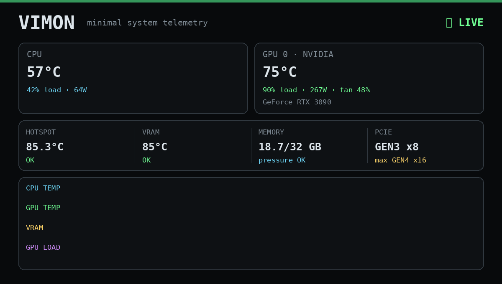

<div align="center">

# Vimon

**Minimal system telemetry. No sensor spam.**

A focused terminal monitor for the hardware metrics that actually matter.

`CPU · GPU · VRAM · RAM · PCIe · Thermals`



<sub>Demo recorded on Windows with the v0.1 layout.</sub>

[](https://github.com/ster01de/vimon/releases)
[](https://github.com/ster01de/vimon/actions/workflows/build.yml)
[](#install)
[](LICENSE)
[](https://dotnet.microsoft.com/)

[Install](#install) · [What it shows](#what-it-shows) · [Windows](docs/platforms/windows.md) · [macOS](docs/platforms/macos.md) · [Linux](docs/platforms/linux.md) · [Roadmap](#roadmap)

</div>

---

## Why Vimon?

Most hardware monitors expose **everything**.

Vimon does the opposite: it surfaces the handful of metrics that help you decide whether the machine is healthy.

- Is the CPU too hot?
- Is the GPU thermally healthy?
- Is GPU memory getting uncomfortable?
- Is RAM pressure becoming a problem?
- Is the GPU actually using the expected PCIe link?
- Is anything worth investigating now?

No 300-row sensor table. No hunting through labels.

```text
+--------------------------------------------------+
| VIMON  - LIVE  (empty rows hidden)               |
| Q quit  P pause  H hide —  <- / -> GPU           |
+--------------------------------------------------+
| STATUS                                           |
| Warning: OS memory pressure elevated             |
+--------------------------------------------------+
| CPU                                              |
| Apple M2                                         |
| Temp        47.1 C                               |
| Load        41.5 %                               |
| Thermal     Nominal                              |
+--------------------------------------------------+
| GPU 1/1                                          |
| Apple M2                                         |
| Core        37.4 C                               |
| Hotspot     40 C                                 |
| Load        18 %                                 |
| Memory      0.4 GB                               |
+--------------------------------------------------+
| MEMORY                                           |
| RAM         6.5 / 8.0 GB                         |
| Usage       81 %                                 |
| Pressure    Warning                              |
+--------------------------------------------------+
```

<sub>macOS · Apple M2 · <code>vimon --once --hide-missing</code></sub>

---

## Install

Prebuilt binaries are attached to every [GitHub release](https://github.com/ster01de/vimon/releases). They are self-contained: no .NET install needed.

### Windows

1. Download `vimon-windows-x64.exe` from the [releases](https://github.com/ster01de/vimon/releases).
2. Run it from a terminal **as administrator**. Without admin rights CPU temperatures and some other sensors stay empty.

The binary is not code-signed yet, so SmartScreen may warn on first start (*More info → Run anyway*).

→ [Windows guide](docs/platforms/windows.md)

### macOS

```bash
curl -fLO https://github.com/ster01de/vimon/releases/download/v0.3.1-alpha/vimon-macos-arm64.tar.gz
tar -xzf vimon-macos-arm64.tar.gz
./vimon
```

Newer version on the [releases page](https://github.com/ster01de/vimon/releases)? Replace `v0.3.1-alpha` in the URL. `-f` makes `curl` stop on a wrong URL instead of saving GitHub's "Not Found" page, which `tar` would reject with *Unrecognized archive format*.

Use `vimon-macos-x64.tar.gz` on Intel Macs. Downloaded with a browser instead of `curl`? Run `xattr -d com.apple.quarantine vimon` once, because the binaries are not notarized yet.

→ [macOS guide](docs/platforms/macos.md)

### Linux

Not available yet: the Linux backend is planned.

→ [What is planned for Linux](docs/platforms/linux.md)

---

## What it shows

| Metric | Windows | macOS |
|---|:---:|:---:|
| CPU temperature | ✓ ¹ | ✓ |
| CPU load | ✓ | ✓ |
| CPU package power | ✓ | — |
| OS thermal state | — | ✓ |
| GPU name, multi-GPU switching | ✓ | ✓ |
| GPU core temperature | ✓ ² | ✓ |
| GPU hotspot temperature | ✓ ² | ✓ ³ |
| GPU memory temperature | ✓ ² | — |
| GPU load | ✓ | ✓ |
| GPU memory used | ✓ | ✓ ⁴ |
| GPU power, fan | ✓ ² | — |
| PCIe link (generation, lanes) | NVIDIA | — |
| RAM used | ✓ | ✓ |
| OS memory pressure | — | ✓ |
| Storage temperature | ✓ | — |

¹ run as administrator · ² when the GPU and driver expose it · ³ hottest GPU sensor · ⁴ unified memory in use by the GPU

Missing values are shown as `—`, never as `0` or `ERROR`. Press `H` to hide them.

Linux has no backend yet, see [Linux](docs/platforms/linux.md).

---

## Status checks

The STATUS section sits at the top and lists what is worth a look right now.

| Check | Warning | Critical |
|---|---|---|
| CPU temperature | ≥ 80 °C | ≥ 90 °C |
| GPU core temperature | ≥ 80 °C | ≥ 85 °C |
| GPU hotspot temperature | ≥ 95 °C | ≥ 105 °C |
| GPU memory temperature | ≥ 95 °C | ≥ 105 °C |
| RAM usage | ≥ 85 % | ≥ 95 % |
| OS memory pressure (macOS) | warning | critical |
| OS thermal state (macOS) | serious | critical |

PCIe running narrower than supported while the GPU is above 50 % load is reported as info.

Thresholds are conservative and the same for every machine for now. Fanless Apple Silicon laptops can run above 80 °C under sustained load by design, so expect CPU warnings there until per-machine [profiles](profiles/) are loaded.

---

## Controls

```text
← / →    switch GPU
P        pause
Space    pause
H        hide / show rows without a value (—)
Q / Esc  quit
Ctrl+C   quit
```

Options:

```text
--once           print one frame and exit
--hide-missing   start with rows without a value hidden
```

On macOS the live view uses the terminal's alternate screen, like `top`: your previous terminal content comes back when you quit. If the window is too short, the frame is cut from the bottom with a hint; STATUS always stays visible.

---

## Philosophy

Vimon is not trying to replace HWiNFO, lm-sensors, iStat Menus or vendor tools.

Those tools expose data.

Vimon tries to expose **meaning**.

```text
VRAM      86°C   OK
HOTSPOT   85°C   OK
GPU       75°C   OK
PCIE      GEN3 x8 / max GEN4 x16

Assessment:
Thermals are healthy.
PCIe width is below the adapter maximum.
Impact is workload-dependent.
```

---

## Build from source

Requires the [.NET 8 SDK](https://dotnet.microsoft.com/download/dotnet/8.0).

```bash
# macOS / Linux
dotnet run --project src/Vimon.Cli -f net8.0

# Windows
dotnet run --project src/Vimon.Cli -f net8.0-windows
# or: .\run.ps1, and .\build.ps1 for a single-file vimon.exe

# Tests
dotnet test
```

The CLI has two target frameworks: `net8.0-windows` uses the LibreHardwareMonitor backend, `net8.0` the macOS and Linux backends.

---

## Architecture

```text
src/
├── Vimon.Core               models, diagnostics, nvidia-smi parsing
├── Vimon.Cli                terminal UI (renderer, window fitting, input loop)
├── Vimon.Platform.Windows   LibreHardwareMonitor + nvidia-smi
├── Vimon.Platform.MacOS     Mach, sysctl, IORegistry, SMC, NSProcessInfo
└── Vimon.Platform.Linux     planned
tests/
├── Vimon.Core.Tests
├── Vimon.Cli.Tests
└── Vimon.Platform.MacOS.Tests   unit tests + integration tests on real macOS APIs
```

GPU data uses a vendor-neutral model. Unsupported metrics are nullable by design. CI builds and tests every change on Windows and macOS.

---

## Roadmap

### Shipped

- **v0.1** Windows backend, multi-GPU, NVIDIA PCIe status, basic diagnostics
- **v0.2.0-alpha** first macOS release: CPU load, RAM, memory pressure, thermal state, GPU load and memory; cross-platform CLI; release binaries for Windows and macOS
- **v0.3.0-alpha** macOS CPU and GPU temperatures via the SMC, no root needed
- **v0.3.1-alpha** hide rows without a value (`H`), alternate screen on macOS, status on top, terminal-height aware drawing

### Next

- [ ] Load [profiles](profiles/) and add Apple Silicon thresholds
- [ ] Network and disk throughput
- [ ] `--compact` one-line view for small terminals and status bars
- [ ] `--json` output
- [ ] Linux backend and Linux release builds
- [ ] AI section: local inference servers, loaded model, tokens per second
- [ ] macOS power (CPU, GPU, Neural Engine)
- [ ] `--gpu` selection, `--log`

What Vimon will not become: see [non-goals](docs/ROADMAP.md).

---

## Product rule

Before adding another sensor, ask:

> Does this metric help the user make a decision?

If not, it probably doesn't belong in the default Vimon view.

---

## License

MIT — see [LICENSE](LICENSE).

<div align="center">

**Less telemetry. More signal.**

</div>
