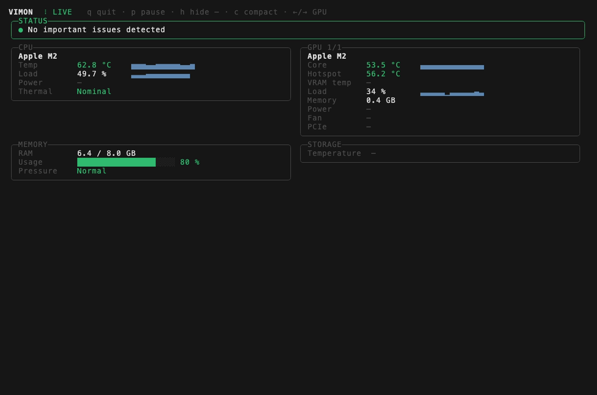

<div align="center">

# Vimon

**Minimal system telemetry. No sensor spam.**

A focused terminal monitor for the hardware metrics that actually matter.

`CPU · GPU · VRAM · RAM · PCIe · Thermals · Network · Processes`


<sub>Real terminal recording on an Apple M2, made with <a href="https://github.com/charmbracelet/vhs">VHS</a> from <a href="docs/demo.tape"><code>docs/demo.tape</code></a>. Nothing staged: the values are what the machine reported.</sub>

[](https://github.com/ster01de/vimon/releases)
[](https://github.com/ster01de/vimon/actions/workflows/build.yml)
[](#install)
[](LICENSE)
[](https://dotnet.microsoft.com/)

[Install](#install) · [What it shows](#what-it-shows) · [Windows](docs/platforms/windows.md) · [macOS](docs/platforms/macos.md) · [Linux](docs/platforms/linux.md) · [Roadmap](#roadmap)

</div>

---

## Why Vimon?

Most hardware monitors expose **everything**.

Vimon does the opposite: it surfaces the handful of metrics that help you decide whether the machine is healthy.

- Is the CPU too hot?
- Is the GPU thermally healthy?
- Is GPU memory getting uncomfortable?
- Is RAM pressure becoming a problem?
- Is the GPU actually using the expected PCIe link?
- Which process is keeping the machine busy?
- Is the network moving data right now?
- Is anything worth investigating now?

No 300-row sensor table. No hunting through labels.



<sub>Still frame from the same recording.</sub>

---

## Install

Prebuilt binaries are attached to every [GitHub release](https://github.com/ster01de/vimon/releases). They are self-contained: no .NET install needed.

### Windows

1. Download `vimon-windows-x64.exe` from the [releases](https://github.com/ster01de/vimon/releases).
2. Run it from a terminal **as administrator**. Without admin rights CPU temperatures and some other sensors stay empty.

The binary is not code-signed yet, so SmartScreen may warn on first start (*More info → Run anyway*).

→ [Windows guide](docs/platforms/windows.md)

### macOS

```bash
curl -fLO https://github.com/ster01de/vimon/releases/download/v0.6.0-alpha/vimon-macos-arm64.tar.gz
tar -xzf vimon-macos-arm64.tar.gz
./vimon
```

Newer version on the [releases page](https://github.com/ster01de/vimon/releases)? Replace `v0.6.0-alpha` in the URL. `-f` makes `curl` stop on a wrong URL instead of saving GitHub's "Not Found" page, which `tar` would reject with *Unrecognized archive format*.

Use `vimon-macos-x64.tar.gz` on Intel Macs. Downloaded with a browser instead of `curl`? Run `xattr -d com.apple.quarantine vimon` once, because the binaries are not notarized yet.

→ [macOS guide](docs/platforms/macos.md)

### Linux

Not available yet: the Linux backend is planned.

→ [What is planned for Linux](docs/platforms/linux.md)

---

## What it shows

| Metric | Windows | macOS |
|---|:---:|:---:|
| CPU temperature | ✓ ¹ | ✓ |
| CPU load | ✓ | ✓ |
| CPU package power | ✓ | — |
| OS thermal state | — | ✓ |
| GPU name, multi-GPU switching | ✓ | ✓ |
| GPU core temperature | ✓ ² | ✓ |
| GPU hotspot temperature | ✓ ² | ✓ ³ |
| GPU memory temperature | ✓ ² | — |
| GPU load | ✓ | ✓ |
| GPU memory used | ✓ | ✓ ⁴ |
| GPU power, fan | ✓ ² | — |
| PCIe link (generation, lanes) | NVIDIA | — |
| RAM used | ✓ | ✓ |
| OS memory pressure | — | ✓ |
| Free disk space per volume | ✓ | ✓ |
| Disk throughput per drive (read, write) | ✓ ¹ | ✓ |
| USB link of external drives (USB 2.0 … USB 3.2 Gen 2x2) | — | ✓ |
| Process causing the most disk traffic | planned | ✓ ⁶ |
| Storage temperature | ✓ | — |
| Network throughput (total, busiest interfaces) | ✓ ⁵ | ✓ ⁵ |
| Busiest processes (CPU, memory) | planned | ✓ ⁶ |

¹ run as administrator · ² when the GPU and driver expose it · ³ hottest GPU sensor · ⁴ unified memory in use by the GPU · ⁵ physical interfaces: loopback, VPN tunnels and known virtual adapters are left out, because their traffic also passes Wi-Fi or Ethernet · ⁶ your own processes: without root, macOS does not reveal CPU time and memory of other users' processes such as WindowServer

Missing values are shown as `—`, never as `0` or `ERROR`. Press `H` to hide them.

Linux has no backend yet, see [Linux](docs/platforms/linux.md).

---

## Status checks

The STATUS section sits at the top and lists what is worth a look right now.

| Check | Warning | Critical |
|---|---|---|
| CPU temperature | ≥ 80 °C | ≥ 90 °C |
| GPU core temperature | ≥ 80 °C | ≥ 85 °C |
| GPU hotspot temperature | ≥ 95 °C | ≥ 105 °C |
| GPU memory temperature | ≥ 95 °C | ≥ 105 °C |
| RAM usage | ≥ 85 % | ≥ 95 % |
| Disk space per volume ⁷ | ≥ 90 % used | ≥ 97 % used |
| OS memory pressure (macOS) | warning | critical |
| OS thermal state (macOS) | serious | critical |

PCIe running narrower than supported while the GPU is above 50 % load is reported as info, and so is an external drive on a USB 2.0 link (or a USB 2.0 hub on the way), which caps copying at roughly 40 MB/s.

⁷ not for volumes with 100 GB or more still free. On macOS the free space is what `df` reports; Finder adds purgeable space and may show more.

Thresholds are conservative and the same for every machine for now. Fanless Apple Silicon laptops can run above 80 °C under sustained load by design, so expect CPU warnings there until per-machine [profiles](profiles/) are loaded.

---

## Controls

```text
← / →    switch GPU
P        pause
Space    pause
H        hide / show rows without a value (—)
C        switch between full and compact view
R        redraw the screen (also Ctrl+L)
Q / Esc  quit
Ctrl+C   quit
```

Options:

```text
--once           print one frame and exit
--compact        one- or two-line view (see below)
--widget         borderless list for transparent desktop panels (see below)
--hide-missing   start with rows without a value hidden
--theme <name>   default, mono or high-contrast (see below)
--no-processes   hide process names, e.g. while sharing your screen
```

The live view uses the terminal's alternate screen where the terminal supports it, like `top`: your previous terminal content comes back when you quit. From 100 columns on, panels sit side by side. Each frame is drawn from the top-left corner, so resizing the window never leaves broken pieces behind. If the window is too short, the view is cut from the bottom; STATUS always stays visible.

### Compact view

For small terminal panes, tmux and status bars. The first word is the overall status, missing values are left out, and a second line appears only when something needs attention:

```text
WARN │ CPU 47°C 33% │ GPU 41°C 18% │ RAM 81% │ NET ↓1.2M ↑310K │ DISK R12M W110M
  OS memory pressure elevated
```

While the status is WARN or CRIT, the second line also names the busiest process (`· top Xcode 23%`); the widget shows it as a `TOP` row. vimon stores and sends nothing, but process names are shown on screen and printed by `--once`, so they can end up in screenshots, recordings or status-bar logs; `--no-processes` leaves them out.

`vimon --once --compact` prints it once without cutting it to the window, so it can feed a status bar. For example in tmux:

```bash
set -g status-right '#(vimon --once --compact | head -1)'
```

### Themes and NO_COLOR

| Theme | For |
|---|---|
| `default` | dark and light terminals |
| `high-contrast` | bright colours for dark or transparent backgrounds, e.g. the desktop widget |
| `mono` | no colours: findings are marked `OK` / `INFO` / `WARN` / `CRIT`, warnings are bold |

Status never depends on colour alone: the STATUS header names the worst level in every theme (`STATUS · WARN`). vimon follows [`NO_COLOR`](https://no-color.org): when it is set, or the terminal has no colours, vimon switches to `mono`. An explicit `--theme` wins over `NO_COLOR`. Output written to a file or pipe (`vimon --once > status.txt`) has no colours either, so it uses the `mono` markers too. `--compact` is plain text in every theme.

### Widget view

`vimon --widget` drops header, key help and borders and uses no background colours, so it can sit on the desktop in a transparent terminal panel. At most 30 columns wide; sparklines disappear below 27:

```text
OK                   16:06:15
CPU   42°C  23%  ▄▅▅▅▅▄▃▄▅▆
GPU   38°C   7%  ▄▆▅▇▂▅▃▂▃▄
RAM         80%  ████████░░
NET ↓1.2M ↑310K  ▁▁▂▅█▆▃▁▁▁
DISK R12M  W110M  ▃▅▇██▇▆▅▃▂
Pressure  Normal
Thermal   Nominal
```

Add `--theme high-contrast` when the widget sits on a transparent background. `--widget` wins over `--compact`; in the widget only `Q` and `Esc` react, so a stray key cannot pause or change it. On macOS, [kitty](https://sw.kovidgoyal.net/kitty/)'s panel turns it into a desktop widget: see [Desktop widget with kitty](docs/platforms/macos.md#desktop-widget-with-kitty).

---

## Philosophy

Vimon is not trying to replace HWiNFO, lm-sensors, iStat Menus or vendor tools.

Those tools expose data.

Vimon tries to expose **meaning**: the STATUS panel on top says in one line per finding what deserves attention, names the worst level in its header (`STATUS · WARN`) and turns its border green, yellow or red with it. Temperatures and bars use the same thresholds, so colour always means the same thing, and nothing depends on colour alone.

---

## Build from source

Requires the [.NET 8 SDK](https://dotnet.microsoft.com/download/dotnet/8.0).

```bash
# macOS / Linux
dotnet run --project src/Vimon.Cli -f net8.0

# Windows
dotnet run --project src/Vimon.Cli -f net8.0-windows
# or: .\run.ps1, and .\build.ps1 for a single-file vimon.exe

# Tests
dotnet test
```

The CLI has two target frameworks: `net8.0-windows` uses the LibreHardwareMonitor backend, `net8.0` the macOS and Linux backends.

---

## Architecture

```text
src/
├── Vimon.Core               models, diagnostics, rate trackers (network, processes), nvidia-smi parsing
├── Vimon.Cli                terminal UI on Spectre.Console: full, compact and widget views, themes, input loop
├── Vimon.Platform.Windows   LibreHardwareMonitor, nvidia-smi, .NET network statistics
├── Vimon.Platform.MacOS     Mach, sysctl, IORegistry, SMC, NSProcessInfo, routing table, libproc
└── Vimon.Platform.Linux     planned
tests/
├── Vimon.Core.Tests
├── Vimon.Cli.Tests
└── Vimon.Platform.MacOS.Tests   unit tests + integration tests on real macOS APIs
```

GPU data uses a vendor-neutral model. Unsupported metrics are nullable by design. CI builds and tests every change on Windows and macOS.

---

## Roadmap

### Shipped

- **v0.1** Windows backend, multi-GPU, NVIDIA PCIe status, basic diagnostics
- **v0.2.0-alpha** first macOS release: CPU load, RAM, memory pressure, thermal state, GPU load and memory; cross-platform CLI; release binaries for Windows and macOS
- **v0.3.0-alpha** macOS CPU and GPU temperatures via the SMC, no root needed
- **v0.3.1-alpha** hide rows without a value (`H`), alternate screen on macOS, status on top, terminal-height aware drawing
- **v0.4.0-alpha** Spectre.Console live view (coloured status, side-by-side panels, sparklines), `--compact` view, real VHS demo
- **v0.5.0-alpha** network throughput (macOS, Windows), `--widget` view for transparent desktop panels such as kitty's
- **v0.6.0-alpha** `--theme` (default, mono, high-contrast) and `NO_COLOR`, busiest processes on macOS, `--no-processes`

### Next

- [ ] Load [profiles](profiles/) and add Apple Silicon thresholds
- [ ] Busiest processes on Windows
- [ ] Busiest disk process on Windows
- [ ] `--json` output
- [ ] Linux backend and Linux release builds
- [ ] AI section: local inference servers, loaded model, tokens per second
- [ ] macOS power (CPU, GPU, Neural Engine)
- [ ] `--gpu` selection, `--log`

What Vimon will not become: see [non-goals](docs/ROADMAP.md).

---

## Product rule

Before adding another sensor, ask:

> Does this metric help the user make a decision?

If not, it probably doesn't belong in the default Vimon view.

---

## License

MIT — see [LICENSE](LICENSE).

<div align="center">

**Less telemetry. More signal.**

</div>
